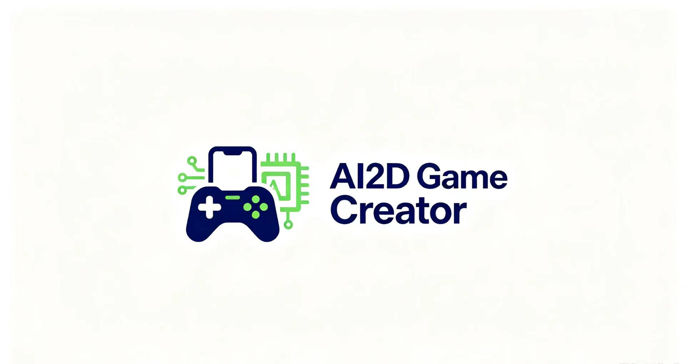

# AI2D Game Creator



AI 赋能的移动端 2D 游戏原型创作平台。面向没有编程基础的游戏爱好者，通过「拖拽交互 + AI 辅助」在移动设备上快速把创意变成可运行、可分享的游戏原型。

## 这个工具现在能做哪种游戏（定位）

**现在只做一类：横版动作 / 平台跳跃类原型。** 跑、跳、重力、碰撞、敌人、道具、
计分与胜负、多关卡 —— 这一类要做到好用、够用。

**明确不承诺的**（不是做不好，是暂时没做）：格子类（贪吃蛇、俄罗斯方块、消除）、
弹球类（打砖块）、卡牌与界面密集类。这些玩法需要的能力 —— 格子地图、
自动弹跳、对象跟随 —— 目前还没有实现，[路线图](docs/ROADMAP.md) 里写明位置。

**但架构上是留了扩展位的**，见下面「以后怎么加别的风格」。

## 以后怎么加别的风格（扩展契约）

这几条不是设想，是这几天**真的做过**的同类改动（所以敢写下来）：

| 想加的能力 | 要改哪里 | 已经验证过的同类改动 |
| --- | --- | --- |
| 新的动作 / 条件（例如"随机位置""跟着某个对象走"） | **只改词汇表一个文件**：加一条声明，编辑器表单和规则句子自动跟上 | 按键候选从手打改下拉、屏幕按键的动作表 —— 都只加数据，没碰界面代码 |
| 新的"碰撞身份"（例如"能踩的""能推的"） | 数据字段加一档 + 运行器按层分配 + 校验器加一条提醒 | 「地面」这一档就是这么加的（顺带学会给老工程写自动升级） |
| 整套新风格（俯视角、塔防…） | 加一层**模板**：新工程时选模板 = 一套实体 + 一套规则 + 可用的词汇子集，核心不动 | 还没做 —— 但它不需要改核心，因为"实体 + 规则"本来就是数据 |
| 格子类玩法 | 补 `tile_grid` 的实现（数据结构里已经有了，运行时与编辑器还没实现） | 还没做。位置写在这里，不留悬念 |

一条纪律：**新增能力只准"加"，不准"改语义"**；非改不可时，必须加版本号并写自动升级
（「地面」那一档的教训写在[决策记录](docs/决策记录.md)里）。

## 当前状态

**M0 基础层、M1 运行器、M2 编辑器、M3 逻辑编辑器 已完成。**

**关卡编辑**：从底部素材栏拖一个对象到画布上、拖动摆位置、撤销重做；在右侧属性面板里改颜色、大小、自定义数值。

**逻辑编辑**：点顶栏「逻辑」进入。左边是规则清单，每条都念成了一句人话；右边用「当……如果……就……」三段式配规则——事件、条件、动作全从下拉框里选，参数表单自动生成。**不需要写一行 JSON。**

点「运行」立刻试玩，点「保存」写回文件。示例里「吃到金币加分」「碰到尖刺扣血」这些，现在都能在界面上点出来了。

**运行器**：一份 JSON 工程能被完整地加载、校验、构建成场景并跑起来——重力、落地、碰撞、可视化规则、胜负结算全部可用。示例「跳跃小恐龙」能玩：方向键移动、空格或点击跳跃、吃金币加分、碰尖刺扣血、集齐金币获胜。

还没做的：**新建**"实体类型"（编辑已有的类型已经能用：点素材栏里的一项就行）、
属性清单、素材系统、分享。详见[路线图](docs/ROADMAP.md)。

**编辑"这一类"**：点底部素材栏里的一项，右边面板就切到「这一类」——
改名字、标签、颜色、**原始大小**、碰撞、会不会动。改动会影响场上所有同类对象
（自己单独设过颜色/碰撞/会动吗的那些不受影响，面板会写清有几个）。
选中一个对象时想改成整类，点面板顶部的「改这一类」。

### 你的作品存在哪

| 目录 | 性质 |
| --- | --- |
| `app/samples/` | **内置示例，只读。**对示例按保存不会覆盖它，而是自动另存到 `projects/` |
| `app/projects/` | **你自己的作品。**编辑器下次打开会自动接着上次那份继续 |

### 已验证

- 自动化测试覆盖数据层、运行器、编辑器、属性面板、逻辑编辑器、AI 助手、触屏手势、模式切换和打包卫生；最新实跑结果见[测试记录](docs/测试清单.md#测试记录)
- 数据层测试不依赖渲染与输入，可在无界面环境下秒级跑完
- 工程文件编码体检：自动发现被编辑器写坏的汉字，并指出第几行

### 已知限制

- 刚体（`rigid`）尚未实现，会被当作 `kinematic` 处理
- 帧动画只记录状态，尚未真正播放逐帧动画
- 编辑器可以修改已有实体类型，但尚无手动新建、删除实体类型的界面
- 属性名、动画名等自由文本仍是英文标识符，句子里会照原样念出来
- 已支持触屏手势与屏幕按键，移动端以横屏平板为主，未针对竖屏手机优化

## 目录结构

| 目录 | 用途 |
| --- | --- |
| `app/` | Godot 4 工程（编辑器 + 运行器） |
| `app/samples/` | 可直接载入的示例工程 |
| `app/projects/` | 你自己的作品，保存时默认写到这里 |
| `docs/` | 架构设计、数据模型、路线图、决策记录、开发文档 |
| `build/` | 构建产物（截图等），不入版本库 |

## 快速开始

### 第一次拿到这个项目（重要）

项目包里**不含 Godot 引擎**——它有 164 MB，占了整个文件夹的 98%，而且只需一份。

1. 去 [godotengine.org/download](https://godotengine.org/download) 下载 **Godot 4.6.1** 的 Windows 版
2. 把 `Godot_v4.6.1-stable_win64.exe` 放到本文件夹的**根目录**（和这几个 `.bat` 放一起）
3. 之后双击任何 `.bat` 都能用了

第一次运行会花几秒钟"准备工程"（生成 Godot 的缓存），之后不再需要。
跳过这一步的话，脚本之间会互相找不到，满屏报错——脚本已经会自动处理，你只需要知道第一次会慢一点。

### 改文件之前，请先看这一条

**用 VS Code 的“文件 → 打开文件夹”打开本项目**。项目里已经配好 UTF-8 编码，直接用就行。

如果你用别的编辑器改 `.ai2d.json`，**保存时务必确认是 UTF-8**。用 GBK 之类的编码保存，
会把中文悄悄写坏——而且 JSON 结构仍然合法、程序照跑不误，只有游戏里的文字变了样，
肉眼极难发现。（这个坑我们实际踩过一次。）

真出问题也不怕：双击 `运行测试.bat`，里面有一条**编码体检**，会直接告诉你哪一行坏了。

### 双击哪个

| 双击 | 做什么 |
| --- | --- |
| `打开编辑器.bat` | **主入口**：打开编辑器，开始创作 |
| `开始游戏.bat` | 直接试玩示例原型「跳跃小恐龙」 |
| `运行测试.bat` | 跑一遍全部自动检查 |
| `构建网页版.bat` | 重新导出网页版（改完代码后跑） |
| `打开网页版.bat` | 本机起服务并打开浏览器，同时打印局域网地址 |
| `构建安卓包.bat` | 打安卓安装包，产物在 `build/android/` |

编辑器里：从底部拖对象到画布；点击选中、拖动移动；滚轮缩放、中键平移；
`Ctrl+Z` 撤销、`Delete` 删除、`F5` 试玩、`Ctrl+S` 保存。
试玩中按 `Esc`，或点右上角的「← 返回编辑」按钮，回到编辑器。

要玩练习原型，在编辑器中打开 `app/samples/practice.ai2d.json`，再点「运行」。

直接试玩示例原型：

```powershell
.\Godot_v4.6.1-stable_win64.exe --path app
```

操作：**方向键**左右移动，**空格**或**点击屏幕**跳跃，按 **R** 重开。

把当前画面截图保存下来（会开一个窗口，截完自动关闭）：

```powershell
.\Godot_v4.6.1-stable_win64.exe --path app res://scenes/capture.tscn -- --out=build/preview.png
```

## 提交到 GitHub

保留源码、内置示例、字体、图片、开发文档与必要脚本。以下文件只留本机，已由 `.gitignore` 排除：

- Godot 引擎、`build/` 构建产物、`app/.godot/` 缓存、`app/android/` 构建模板。
- `app/projects/` 用户作品、`app/export_presets.cfg` 签名配置及密钥文件。
- 根目录的 `项目计划书.doc` 原始比赛材料。

克隆后按上面的步骤安装 Godot 即可编辑、试玩与运行测试；重新导出需要自行配置导出预设与工具链。
`.uid` 是脚本的稳定标识，应保留在仓库中。

本次整理只从当前版本取消跟踪计划书，**旧 Git 提交仍包含该文件**。
如果使用本次生成的 `build/AI2D-GitHub-source.zip` 上传到一个新仓库，包内不包含旧历史和本机文件。
如果直接推送现有仓库，历史会一并上传。

## 文档

- [文件夹导览](docs/文件导览.md) —— 每个文件是干什么的，从这份开始看
- [项目交接文档](PROJECT_HANDOFF.md) —— **给接手的 AI 的完整交接**（需求/架构/现状/决策/待办）
- [交接说明](docs/交接说明.md) —— **接手项目先看这份**；给 AI 助手看的是根目录的 `AGENTS.md`
- [项目进度汇报](docs/项目进度汇报.md) —— 给别人看的一页总结，可以直接转发
- [决策记录](docs/决策记录.md) —— 每个决定的"为什么"，接手项目先读这份
- [项目复盘](docs/项目复盘.md) —— 至今做了什么、踩过哪些坑、还差什么
- [数据模型](docs/DATA_MODEL.md) —— JSON 里每个字段是什么意思
- [架构设计](docs/ARCHITECTURE.md) —— 为什么这么分层、为什么选 Godot
- [路线图](docs/ROADMAP.md) —— 每个阶段做什么
- [团队会议提纲](docs/团队会议提纲.md)
