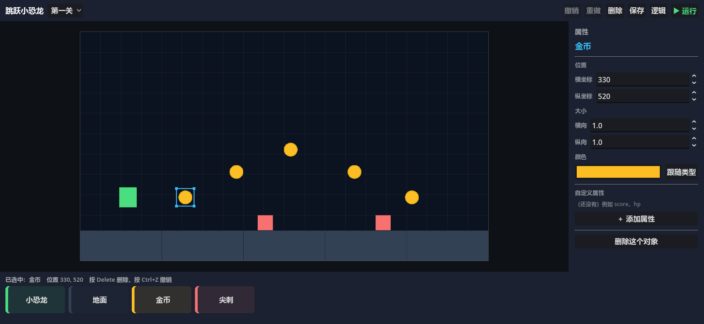
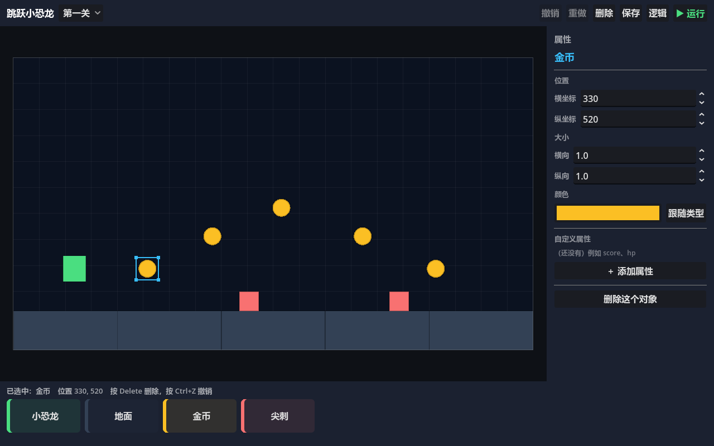

# 移动端适配方案讨论

> 这份文档是给团队看的：我们在哪、遇到什么问题、有哪几条路、建议走哪条。
> 阅读时间约 5 分钟。

## 一、现在的进展

编辑器已经能用了：拖对象、改颜色大小、配逻辑规则、即时试玩、保存。
**"不写代码做出一个能跑的游戏"这件事已经跑通了。**

但整个界面是**按电脑屏幕和鼠标设计的**，还没针对触屏改过。

## 二、遇到的问题：手机上到底能不能用？

我们量了一下。界面按 1280×720 的逻辑尺寸设计，在真实设备上会整体缩放：

| | 工具栏按钮的实际高度 | 触屏建议的最小值 | 需要放大 |
| --- | --- | --- | --- |
| **手机**（6.5 寸，2340×1080） | 2.9 毫米 | 7 毫米 | **2.4 倍** |
| **平板**（11 寸，2560×1600） | 5.6 毫米 | 7 毫米 | 1.25 倍 |

**结论很清楚：平板只差一点点，手机差得远。**

我们也按两种屏幕比例渲染出来看过（图在下面）。**布局本身放得下、不会散架**，
问题不在"排不开"，而在"点不准"——手机上按钮太小，手指按下去会经常按错。

## 三、为什么会"局促"

把按钮放大到该有的大小，顶栏和底栏加起来会吃掉**四成屏幕高度**，
留给画布的地方就很小了。

在平板上只放大 1.25 倍，几乎看不出变化；在手机上要放大 2.4 倍，才是真的挤。

**"手机屏幕太小，做游戏施展不开"——这个判断是对的，而且算下来差距很具体。**

## 四、三条路

### 方案 A：以平板横屏为主场

- 布局结构**一个字不改**，还是现在这个"画布 + 右侧属性面板"
- 只做两件事：加触屏手势、把按钮放大 1.3 倍左右
- 手机能装能跑，但不追求好用

**工作量：小。** 大约是方案 C 的一半。

### 方案 B：硬做手机版

- 底部抽屉、超大按钮、砍掉一部分功能
- 屏幕就那么大，做完还是会挤

**工作量：中，但效果仍然有限。**

### 方案 C：自适应（宽屏分栏、窄屏抽屉）

- 看起来最理想，两种设备都好用
- 但实际上要**多做一整套抽屉**：容器、开合动画、面板页签、拖拽关闭

**工作量：最大。** 因为它是方案 A 的全部，再加抽屉那一整套。
我们一度以为它"介于两者之间"，仔细算过之后确认它是最大。

### 方案 A+（推荐）

在方案 A 基础上，**加一个"收起侧栏"的按钮**（大约二十行代码）：

- 手机上：收着侧栏拖对象、摆位置；要改数值时展开侧栏，改完再收起
- 平板上：同样有用，给画布腾地方

比 A 多一点，比 C 少很多，手机也能勉强用。

## 五、我们的建议

**走方案 A+。** 理由：

1. **"移动端"不等于"手机"。** 一台 11 寸平板横屏，屏幕面积是手机的两倍多，
   基本就是一台小笔记本——它同样是移动设备、同样触屏、同样能带出去。
2. 方案 C 多出来的那套抽屉，在手机上**并不能把体验做到好**，
   只能做到"不那么差"。
3. 我们现在最该保证的是**演示效果**和**顺利结题**，
   而不是把每条产品线都做圆。

## 六、需要团队一起定的两件事

**1. 产品的主战场定在哪？**

是"平板横屏为主、手机能用就行"，还是"手机必须好用"？

**2. 结题演示用什么设备？**

笔记本？手机装 APK 现场演示？还是平板？

**这一条最关键**，它直接决定我们值不值得为手机版多花力气：

- 演示用笔记本 → 手机适配做到"能装能跑"即可
- 演示用手机 → 收侧栏、放大按钮这两条必须做扎实
- 有平板 → 正好落在方案 A 的舒适区

## 七、这件事本身值得写进结题材料

计划书里写的是"随时随地创作游戏"。**我们自己上手用过之后发现：小屏幕上施展不开。**

这是一个真实的产品判断，比硬撑着说"手机上也好用"有说服力得多。可以这样写：

> 实测发现手机屏幕面积不足以支撑关卡编辑，因此将主战场定为横屏平板，
> 手机端聚焦快速试玩与轻量调整。

**它证明我们真的想过、也真的用过。**

---

## 八、最终决定（2026-09-19）

**走方案 A：以横屏平板为主场，不含「收起侧栏」。**

做决定前又把账算细了一遍，两个结论修正了之前的判断：

### 修正一：收起侧栏在手机上几乎没用

手机上挤的是**高度**，不是宽度：

| 手机横屏（逻辑区域 1560×720） | 现在 | 按钮放大到该有的大小后 |
| --- | --- | --- |
| 顶栏 | 47 | 约 110 |
| 底栏 | 110 | 约 250 |
| **合计** | 157（22%） | **360（一半）** |

剩 360 给画布，而画布是 1280×720 的，只能缩到一半（显示成 640×360）。
**这时候收起侧栏一点帮助也没有** —— 限制来自高度，侧栏收不收画布都一样大。

平板就完全不同（逻辑区域 1280×800）：上下栏放大后只占四分之一，
画布还能保持 77% 的大小。

### 修正二：方案 C 是工作量最大的，不是中间那个

它能做到，但要多做一整套抽屉：容器、开合动画、面板页签、拖拽关闭。
而这些在手机上换来的只是"不那么差"。

### 所以最终只做两件事

1. **触屏手势**：单指拖对象、单指拖空白处平移画布、双指捏合缩放
2. **按钮放大**到触屏该有的大小（约 1.3 倍），平板上的手感就够了

**手机的定位**：能装、能跑、能玩——试玩原型、看规则、微调数值。
**不承诺在手机上做关卡编辑。**

### 不做的事

- 底部抽屉（方案 C）
- 收起侧栏（对手机没帮助）
- 竖屏布局
- 双指旋转画布（会把坐标换算搅乱，收益不大）

---

## 九、设备与安装方式（2026-09-19 讨论）

### iPad 装不了我们的程序

苹果的应用必须用 Mac 上的 Xcode 编译，装到真机还需要开发者账号（99 美元/年）。
**安卓那种"下载个 APK 装上"的路子，在苹果这儿不存在。**
这台电脑是 Windows，没有 Mac，所以 iOS 打包这条路走不通。

### 但 iPad 可以跑网页版

Godot 能把项目导出成网页，Safari 直接打开就能用——不需要 Mac、不需要开发者账号、不需要装任何东西。
而且**一份导出，iPad / 安卓 / 电脑都能跑**。

### 网页版的缺点（按严重程度）

| # | 问题 | 影响 |
| --- | --- | --- |
| 1 | **必须有人托管**：要开着电脑跑本地服务、平板连同一个 WiFi、防火墙放行 | 答辩现场的 WiFi 常常上不了外网，甚至客户端互相隔离——**演示可能打不开** |
| 2 | 第一次打开要等十几秒（引擎本体几十兆要先下载） | 扫码之后盯着进度条，观感不好 |
| 3 | **Safari 会跟手势打架**：双指捏合默认缩放网页、长按弹选择菜单 | 要专门写页面配置去屏蔽，且不同 Safari 版本行为有差异 |
| 4 | Safari 会把页面"回收"掉（切后台回来可能重启） | 没保存的东西会丢 |
| 5 | 存不了工程到磁盘，只能存在浏览器里；换一个网址就找不到 | "保存"要重新设计 |
| 6 | **交不了"安装包1套"** | 计划书预期成果里明确写了这条，网页版是个网址 |
| 7 | WebAssembly 比原生慢 | 对象一多可能感觉钝 |

### 结论

**网页版是很好的验证工具，但不适合当答辩的压轴。**

| 用途 | 网页版合适吗 |
| --- | --- |
| 在 iPad 上亲手试触屏手势 | ✅ 正合适，成本最低 |
| 开发过程中来回验证 | ✅ 合适 |
| 答辩现场演示 | ⚠️ 有 WiFi 依赖，风险大 |
| 满足计划书的「安装包1套」 | ❌ 交不了差 |

### 分三步走

1. 先下载 **1.2 GB 的导出模板**——两条路都要用同一份，先下不亏
2. 做**网页版**：十分钟，立刻能在 iPad 上试手势
3. **安卓安装包**作为下一步：多要约 1 GB 下载和几步必须手动完成的安装，
   换来的是「断网也能演示」和「计划书里的安装包承诺」

### 待团队确认

1. 手上有什么设备？iPad / 安卓平板 / 安卓手机？
2. **答辩演示打算用什么设备？** 这条决定值不值得为安卓安装包多花那 1 GB 和手动安装。
